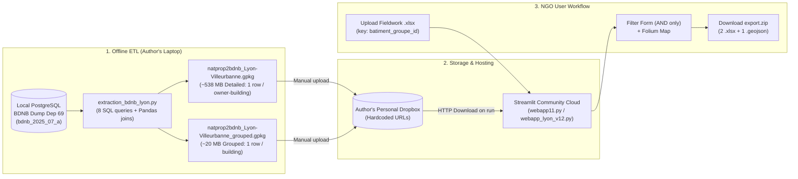

# TeZeLoMa / TeZeLoPa — Technical Assessment & Modernization Plan

> [!NOTE]
> **Context & Mission:** TeZeLoMa (*Territoire Zéro Logement Mal Adaptés Climatiquement*) is a tool built for an NGO helping tenants and activists identify poorly insulated or overheating buildings and pressure "bad" landlords (particularly institutional/corporate landlords and concentrated property owners) into renovating. The original tool was built by a social studies graduate student; the NGO members are non-technical, and the goal is to **secure control, drastically cut maintenance overhead, fix current UX/data bottlenecks, and expand insights (especially on summer overheating)**.

---

## 1. Mystery Solved: What is the Missing Code (`import func`)?

In both [extraction_bdnb_lyon.py](file:///home/sebastien/.gemini/antigravity/scratch/tezeloma-assessment/tezeloma/extraction_bdnb_lyon.py#L10) and [extraction_bdnb.py](file:///home/sebastien/.gemini/antigravity/scratch/tezeloma-assessment/tezeloma-cartographie/extraction_bdnb.py#L10), line 10 states:
```python
import func
```
**Good news: `func` is 100% dead code (an unused import)!**
- A full search across every file and every commit in both Git repositories shows `func` is **never called** anywhere in `extraction_bdnb_lyon.py` or `extraction_bdnb.py`.
- Simply deleting `import func` on line 10 makes the extraction script completely self-contained.

### What did `func.py` originally do in the student's early prototype (`v0.1`–`v0.6`)?
Even though it is no longer used, clues left in comments and filenames reveal what the student was doing before discovering that the BDNB PostgreSQL dump already contained everything:
1. **Parsing DGFiP's *Fichier des locaux des personnes morales* (`natprop`)**:
   - Look at lines 135–136 and 197–198 of [extraction_bdnb_lyon.py](file:///home/sebastien/.gemini/antigravity/scratch/tezeloma-assessment/tezeloma/extraction_bdnb_lyon.py#L135-L136):
     ```python
     #Merge with FichierDesLocaux ON personne_id
     #merged_df = df.merge(natprop, on='personne_id', how='inner')
     ```
   - And the output filename prefix: `natprop2bdnb_Lyon-Villeurbanne.gpkg`.
   - Originally, the author likely wrote helper functions in `func.py` to parse the raw DGFiP CSV/fixed-width tax files (*Fichiers Fonciers / MAJIC Personnes Morales*) and join them with BDNB via `personne_id = concat(num_departement, num_majic)`. Later, they realized the BDNB table `bdnb.proprietaire` and `bdnb.rel_batiment_groupe_proprietaire` **already include** the open MAJIC corporate owner data (`nb_locaux_open`, `siren`, `denomination`, `forme_juridique`), so they commented out the merge and left `import func` at the top!
2. **Early API calls**: `import requests` and `import json` (lines 12 & 16) are also **completely unused** in `extraction_bdnb_lyon.py`. The student likely first tried querying the BDNB REST API in `func.py`, hit rate limits or pagination hurdles on ~50,000 buildings, and switched to downloading the full PostgreSQL dump locally.

> [!TIP]
> **Bottom Line on Missing Code:** You aren't missing any business logic at all! All the active ETL logic and all the frontend logic are present in the two repositories.

---

## 2. Current Architecture & Functionality Map



### A. Offline Data Pipeline ([extraction_bdnb_lyon.py](file:///home/sebastien/.gemini/antigravity/scratch/tezeloma-assessment/tezeloma/extraction_bdnb_lyon.py))
1. **Scope:** Hardcoded for 10 INSEE communes / postal codes covering **Lyon (1er–9e) and Villeurbanne** (`69001`–`69009`, `69100`).
2. **8 Sequential Extraction Modules** querying a local Postgres database (`bdnb_2025_07_a_open_data_dep69`):
   - `batiment_groupe`: Building footprint geometry (`geom_groupe` in EPSG:2154) and `batiment_groupe_id`.
   - `rel_batiment_groupe_proprietaire`: Links buildings to owners (`personne_id`, `nb_locaux_open`).
   - `proprietaire`: Corporate/institutional owner details (`siren`, `forme_juridique`, `denomination`, `code_postal`, `libelle_commune`, `nb_locaux_open`).
   - `batiment_groupe_dpe_representatif_logement`: Representative DPE label (`classe_bilan_dpe`), heating type, exterior wall insulation & material, building type.
   - `batiment_groupe_dpe_statistique_logement`: Counts of dwellings per DPE class (`nb_classe_bilan_dpe_a` through `g`).
   - `batiment_groupe_ffo_bat`: Property tax building attributes (`nb_log` = number of dwellings, `usage_niveau_1_txt`, `annee_construction`).
   - `rel_batiment_groupe_adresse` & `adresse`: Street number, street name, postal code, city.
3. **Merge & Detailed Output (`ModuleMergeData`)**:
   - Joins all 8 CSVs into a massive denormalized table (`natprop2bdnb_Lyon-Villeurbanne.gpkg`, ~538 MB) where **1 row = 1 building × 1 owner × 1 address**.
4. **Building-Level Aggregation (`ModuleGroupStatistics`)**:
   - Collapses the detailed table into **1 row = 1 building** (`natprop2bdnb_Lyon-Villeurbanne_grouped.gpkg`, ~20 MB) with:
     - `nb_log`: Total dwellings in the building.
     - `dpe`: Representative DPE class (A–G).
     - `pourcentage_dpe_a` .. `g` & `pourcentage_dpe_inconnu`: Share of dwellings in each DPE class (or without DPE).
     - `formes_juridiques`: List of legal forms of owners in the building (adds `"personne_physique"` when `forme_juridique` is null/missing).
     - `concentration_prop_max`: Maximum share of open corporate premises held by a single corporate owner in the building.
     - `concentration_prop_max_denomination`: Name (`denomination`) of the largest corporate owner in the building.
     - `adr`, `cp`, `geometry`.

### B. Web Application ([webapp11.py](file:///home/sebastien/.gemini/antigravity/scratch/tezeloma-assessment/tezeloma-cartographie/webapp11.py) & [webapp_lyon_v12.py](file:///home/sebastien/.gemini/antigravity/scratch/tezeloma-assessment/tezeloma/webapp_lyon_v12.py))
- **Two spaces in `webapp11.py`** (simplified to single space in `webapp_lyon_v12.py`):
  - **Demo space**: Public basic filters.
  - **Member space (`TeZeLoPa`)**: Protected by a hardcoded password (`{"tezelopa": "2025!Tezelopa"}` directly in public GitHub code!).
- **Custom Fieldwork Merge (Excel Upload)**:
  - NGO members can upload an `.xlsx` spreadsheet from their fieldwork containing a `batiment_groupe_id` column plus any custom columns (e.g., tenant complaints, visit dates, temperature measurements).
  - The app merges their Excel columns onto the BDNB buildings in memory and auto-generates **"Dynamic Filters"** (numeric sliders or categorical multiselects) for every custom column.
  - Offers two modes: **Lié** (intersect permanent BDNB filters with fieldwork rows) or **Non-lié** (only filter on the uploaded fieldwork rows).
- **Permanent Filters**:
  - Postal code (`cp`)
  - Representative DPE (`dpe`)
  - Minimum % of dwellings in DPE A, B, C, D, E, F, G, or Unknown (`0–100%` sliders)
  - Owner legal form (`formes_juridiques`) with *inclusif* vs *exclusif* toggle
  - Largest landlord name (`concentration_prop_max_denomination`)
  - Minimum number of dwellings (`nb_log`)
  - Property concentration (`concentration_prop_max` %)
- **Cartography (Folium)**:
  - Displays filtered building footprints on OpenStreetMap or CartoDB Positron with popups and an address search bar.
- **ZIP Export (`export.zip`)**:
  - Downloads the 538 MB detailed `.gpkg` from Dropbox on the fly, runs a SQL `WHERE batiment_groupe_id IN (...)` via Fiona, and packages:
    1. `tableur_groupe_*.xlsx` (1 row = 1 building)
    2. `tableur_detaille_*.xlsx` (1 row = 1 owner/address in those buildings, with SIREN & MAJIC details)
    3. `carte_groupee_*.geojson` (for import into Framacarte / uMap).

---

## 3. Critical Pain Points & Technical Debt Found in Audit

> [!WARNING]
> **Why the NGO is worried about losing control — Immediate Fragilities:**
> 1. **Dropbox Single Point of Failure:** The app downloads its data from personal Dropbox URLs belonging to the student. If the student reorganizes their Dropbox, runs out of quota, or revokes links, the app dies immediately.
> 2. **538 MB Download on Export:** Because `get_file_path_from_dropbox` for the 538 MB detailed `.gpkg` is called inside the `if submit:` block (and in `webapp_lyon_v12.py`, note that `commune_nom = "Paris"` is set on line 8 while downloading the Lyon file!), generating an export requires streaming 538 MB to the ephemeral Streamlit container disk.
> 3. **Hardcoded Credentials & Bloated `requirements.txt`:** Passwords in cleartext on GitHub; `requirements.txt` is a 120–188 line `pip freeze` dump of an entire local Conda/venv environment (including `pywin32` or platform-specific packages that broke builds 12 times in commit history!).
> 4. **Painful UX Workarounds:** Look at lines 112–115 of `webapp_lyon_v12.py` — the app literally instructs NGO users that if they want buildings with DPE **F OR G**, they must run the filter once for F, download the zip, run it again for G, download the zip, and manually copy-paste the Excel files together! (Even though `st.multiselect` already supports selecting `['F', 'G']` with `.isin()`, the author got confused or broke state reset after each submission!).
> 5. **Filter Reset Bug:** At the bottom of `if submit:` (lines 777–796), the script deletes all filter keys from `st.session_state`, which resets the user's form inputs every time they click "Générez la carte"!
> 6. **ETL N+1 Query Bottleneck:** In `extraction_bdnb_lyon.py`, instead of doing a SQL `JOIN` or `WHERE code_commune_insee IN (...)`, the script loops in Python over ~50,000 `batiment_groupe_id`s and runs **50,000 individual `SELECT` queries** per table (over 350,000 queries total!). What probably took hours on the student's laptop can be done in **< 3 seconds** with a single SQL query or DuckDB reading BDNB Parquet/CSV files directly.

---

## 4. Data Sources Investigation & Expanding to Summer Overheating

### A. Where Current Data Comes From
All current data comes from a **single open-data product**: the **BDNB Open Data (Base de Données Nationale des Bâtiments)** published by the **CSTB** (Centre Scientifique et Technique du Bâtiment).
- BDNB already cross-references and aggregates:
  1. **IGN BD TOPO** (building footprints & heights)
  2. **DGFiP Fichiers Fonciers / MAJIC Personnes Morales** (building residential counts, construction year, corporate/institutional owners `proprietaire` & `rel_batiment_groupe_proprietaire`) *(Note: French privacy law CNIL restricts open data to **personnes morales** — companies, SCIs, social housing bailleurs, public entities — whereas individual private landlords' names are anonymized outside of restricted "Ayants Droit" access).*
  3. **ADEME DPE** (Diagnostic de Performance Énergétique)
  4. **BAN** (Base Adresse Nationale)

### B. Unused Goldmine Already Inside BDNB (For Overheating & Insulation!)
The student only extracted 7 columns from BDNB, leaving out critical columns that **already exist in BDNB Open Data**:
- **Summer Comfort / Overheating indicators in BDNB & ADEME DPE**:
  - ` confort_ete` / `indicateur_confort_ete` (from ADEME DPE: *bon / moyen / insuffisant*)
  - Presence of sun protection / shutters (`protection_solaire_exterieure`), roof insulation (`isolation_toiture`), dual-aspect ventilation (`logement_traversant`), inertia (`classe_inertie_batiment`), glazing type, and building height/floors.
  - Thermal renovation history and solar potential.

### C. External Open Data Sources to Add (French Cities / Lyon Métropole)
To build a first-class **Summer Overheating + Thermal Slum ("Passoire Thermique")** assessment tool:

| Theme | Dataset / Source | Format / API | Value for the NGO |
| :--- | :--- | :--- | :--- |
| **1. Urban Heat Islands (ICU)** | **Data Grand Lyon** (*Îlots de chaleur urbains / Températures de surface Landsat / LCZ - Local Climate Zones*) & **CEREMA / Météo-France** | WFS / GeoJSON / WMS API | Overlay surface temperature anomalies & heat vulnerability zones directly on buildings: a DPE F/G building with poor roof insulation inside a severe Urban Heat Island is top priority in summer. |
| **2. Granular Apartment-level DPEs** | **ADEME Open Data (`dpe03existant`)** | REST API (Data-Fair) + Parquet/CSV dumps | BDNB only gives a "representative" DPE or counts per building. ADEME's live API gives every individual DPE certificate with exact floor, surface, `indicateur_confort_ete`, and date of diagnosis. |
| **3. Corporate Landlord Unmasking (SCI / Bailleurs)** | **API Recherche d'Entreprises (data.gouv.fr / INSEE Sirene / RNE)** | Free public REST API (no auth key needed) | Given the `siren` in BDNB, instantly fetch the **actual directors/managers (dirigeants)** of opaque real-estate SCIs ("Sociétés Civiles Immobilières") and parent companies! |
| **4. Social Vulnerability & Rent Control** | **INSEE Filosofi (200m grid)** & **Encadrement des Loyers (Lyon/Villeurbanne)** | GeoPackage / GeoJSON | Identify low-income / high-tenant-share blocks and reference rent ceilings in Lyon & Villeurbanne. |
| **5. Co-ownership Registry** | **Registre National des Copropriétés (RNIC - ANAH)** | Open CSV / API | Identify the *Syndic* managing the building, number of lots, and whether the building is in financial difficulty or under an administrative caretaking plan. |

---

## 5. Architecture & Low-Maintenance / Serverless Exploration

Since the NGO has **zero technical staff**, every moving part (servers, databases, expiring auth tokens, complex Python environments) is a liability. Here is how we can re-architect the pipeline and the app:

### Part 1: Eliminating the Local PostgreSQL ETL
Instead of installing PostgreSQL/PostGIS and running 350,000 queries on a laptop:
- **CSTB publishes BDNB per-department dumps in GPKG and CSV/Parquet** (and hosts an API).
- Using **DuckDB** (in a 50-line Python script or GitHub Action running once every 6 months when CSTB releases a new millésime), we can join the BDNB tables for any department in **seconds** and output a single optimized **GeoParquet** / **PMTiles** / **SQLite/DuckDB** file.

### Part 2: Frontend & Hosting Options (From "Zero-Backend" to "Lightweight App")

| Architecture Option | How It Works | Maintenance & Cost | Pros & Cons for the NGO |
| :--- | :--- | :--- | :--- |
| **Option 1: 100% Static Web App + Cloud Bucket (Zero-Backend)** *(Recommended Long-Term)* | **Static SPA** (HTML/JS or lightweight Preact/Svelte + **MapLibre GL JS** + **DuckDB-Wasm** + **SheetJS**) hosted on **GitHub Pages / Cloudflare Pages**. Data stored as static **PMTiles** (vector tiles) + **Parquet** in a free **Cloudflare R2 / S3 / GitHub Release** bucket. | **Near Zero** (\$0/mo, no Python server to sleep or crash, no package rot). | **Pros:** Instant rendering of all 60,000+ buildings in Lyon at 60fps (unlike Folium which chokes over ~2,000 polygons); SQL filtering runs in-browser via DuckDB-Wasm; live API calls to `recherche-entreprises.api.gouv.fr` for SCI owners; Excel upload/merge works 100% in browser.<br>**Cons:** Requires rewriting the UI from Streamlit to JS/HTML. |
| **Option 2: Cleaned-up Streamlit + DuckDB + Static Bucket** *(Best Short-Term Quick Win)* | Keep **Streamlit**, replace the 8-file/538MB GeoPackage mess with a single compressed **GeoParquet** or **DuckDB** file (~15–30 MB total for both buildings and owners!) hosted on GitHub Releases or S3/R2. Pin a minimal `requirements.txt` (6 packages instead of 188). | **Low** (\$0/mo on Streamlit Community Cloud, easy for a Python data scientist to tweak). | **Pros:** Can be fixed and deployed in 1–2 days; keeps familiar interface for NGO; fixes the OR filter bug, session state reset bug, and 538MB download.<br>**Cons:** Streamlit Community Cloud goes to sleep after inactivity; Folium still struggles if the user doesn't filter down to a few hundred buildings first. |
| **Option 3: Persist Shared Fieldwork via Lightweight Cloud Sheet / Bucket** | Currently, if an NGO member uploads an Excel file of field notes, **it disappears when they close the tab**. We can optionally allow linking a shared **Framacalc / Google Sheet / CryptPad / S3 JSON** or local browser storage (`IndexedDB`) keyed by `batiment_groupe_id`. | **Zero to Very Low** | **Pros:** Solves the biggest functional limitation noted in the app's warning text (*"l'application la détruira une fois la page web fermée"*). |

---

## 6. Proposed Roadmap

1. **Phase 1 — Stabilize & Version Control (Immediate)**
   - Initialize clean Git repository under your `sebastienbrg` GitHub account.
   - Download the actual `.gpkg` data files from the Dropbox links *right now* so we have a local backup before those Dropbox links ever expire!
   - Inspect the exact schema and row counts of the Lyon-Villeurbanne datasets.
2. **Phase 2 — Fast Refactor of the Existing Tool (Quick Win for the NGO)**
   - Compress the 538 MB detailed `.gpkg` + 20 MB grouped `.gpkg` into normalized Parquet/DuckDB tables (~95% size reduction: separating `buildings` and `building_owners` eliminates the massive geometry duplication across rows!).
   - Fix the Streamlit bugs (broken filter resets, forced manual Excel concatenation for `F OR G`, hardcoded passwords moved to `st.secrets`, clean 6-line `requirements.txt`).
3. **Phase 3 — Enrich Data (Overheating, Insulation & SCI Unmasking)**
   - Re-run a clean DuckDB extraction on BDNB + ADEME DPE + Grand Lyon Urban Heat Islands (ICU) to add summer comfort, roof insulation, construction period, and heat island exposure.
   - Add one-click lookup of corporate landlord directors via the French government's open *API Recherche d'Entreprises*.
4. **Phase 4 — Serverless / Zero-Maintenance Architecture**
   - Prototype a lightweight static browser app (MapLibre + DuckDB-Wasm or pre-indexed JSON/Parquet) hosted on GitHub Pages / Cloudflare Pages so the NGO never has to worry about Python dependency updates or server downtime again.
