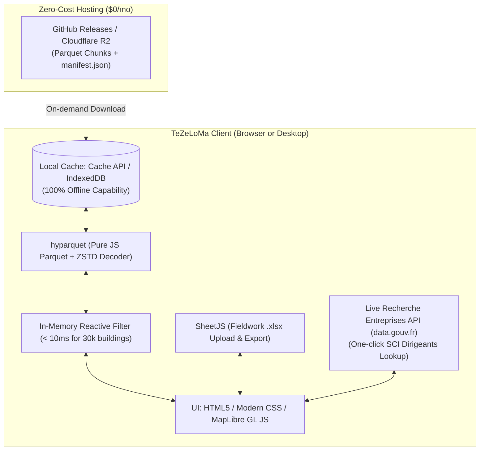

# TeZeLoMa — Standalone Web & Desktop Architecture

## Overview

This architecture cuts all ties with Python web servers (Streamlit) at runtime, replacing them with a **client-side static web application (SPA / PWA)** and an optional **standalone desktop executable (Tauri)**.



---

## 1. Parquet Dataset Chunking & Postal Code Ranges

The dataset is partitioned into lightweight chunks by postal code (`cp`) and department (`dep`) via [app/chunk_dataset.py](file:///home/sebastien/.gemini/antigravity/scratch/tezeloma-assessment/app/chunk_dataset.py).

### Real Measured Benchmark (Current 24 Postal Codes in Repo):
- **Total buildings:** 63,988 (~20 MB total)
- **Total corporate owners:** 70,968 (~1.7 MB total)
- **Time to partition:** ~3.5 seconds

### Sample Postal Code Chunks:
| Postal Code | Commune | Buildings | Owners | Chunk Download Size |
| :--- | :--- | :--- | :--- | :--- |
| **38800** | Le Pont-de-Claix | 926 | 547 | **~340 KB** |
| **69001** | Lyon 1er Arrondissement | 1,646 | 3,188 | **~690 KB** |
| **69003** | Lyon 3e Arrondissement | 5,111 | 7,452 | **~1.9 MB** |
| **69100** | Villeurbanne (Largest) | 7,895 | 7,960 | **~2.6 MB** |
| **Dept 38 Bundle** | Grenoble & Métropole | 31,610 | 23,183 | **~9.7 MB** |
| **Dept 69 Bundle** | Lyon & Villeurbanne | 32,378 | 47,785 | **~11.4 MB** |

### Postal Code Range Support:
When an NGO user enters a range such as `69001` to `69009` (all of Lyon) or `38000` to `38400`:
1. The app filters `data/chunks/manifest.json` for all chunks where `start_cp <= cp <= end_cp`.
2. Fetches the required chunks in parallel (only missing ones, using browser local cache).
3. Concatenates rows in client memory and fits map view to the combined bounding box.

---

## 2. Running Locally

To test the static web application locally:

```bash
# 1. (Optional) Rebuild the dataset and postal-code chunks:
.venv/bin/python app/build_dataset.py

# 2. Start the lightweight local HTTP runner:
python3 app/run_static.py
```
Open [http://localhost:8080/app/static_app/index.html](http://localhost:8080/app/static_app/index.html).

---

## 3. GitHub Hosting & Releases ($0 / month)

### A. Hosting the Static Web App (GitHub Pages)
The static app has zero server dependencies.
The repository includes [.github/workflows/deploy-pages.yml](file:///home/sebastien/.gemini/antigravity/scratch/tezeloma-assessment/.github/workflows/deploy-pages.yml).
Whenever code is pushed to `master`, GitHub Pages builds and publishes the app automatically at:
`https://<username>.github.io/tezeloma-assessment/`

### B. Hosting Data Chunks (GitHub Releases)
Run the release script to publish all postal-code Parquet chunks to GitHub Releases:
```bash
./app/release_data.sh v1.0-data
```
The chunks are accessible at:
`https://github.com/<owner>/tezeloma-assessment/releases/download/v1.0-data/`

In the static app UI, click **"📦 Données & Chunks"** and paste this URL into the **Source d'hébergement** field (or click the "GitHub Releases" shortcut).

---

## 4. Standalone Desktop App (With or Without Installer)

The app can be packaged as a standalone native desktop application using [Tauri](https://tauri.app/):

### Packaging Options:
1. **Without Installer (Portable Mode):**
   - Produces a single executable (`TeZeLoMa.exe` on Windows, `TeZeLoMa.AppImage` on Linux).
   - User double-clicks and runs immediately without installation or admin privileges.
   - Size: **~12 MB**.
2. **With Installer:**
   - Produces standard setup installers (`.msi` / NSIS `.exe` on Windows, `.deb` on Linux, `.dmg` on macOS).
   - Automatically installs shortcuts in the Start Menu and desktop.

### Automated Cloud Builds via GitHub Actions:
The repository includes [.github/workflows/build-desktop.yml](file:///home/sebastien/.gemini/antigravity/scratch/tezeloma-assessment/.github/workflows/build-desktop.yml).
When you push a Git tag (e.g. `git tag v2.0.0 && git push origin v2.0.0`), GitHub Actions automatically compiles Windows, Linux, and macOS installers for **$0**!
