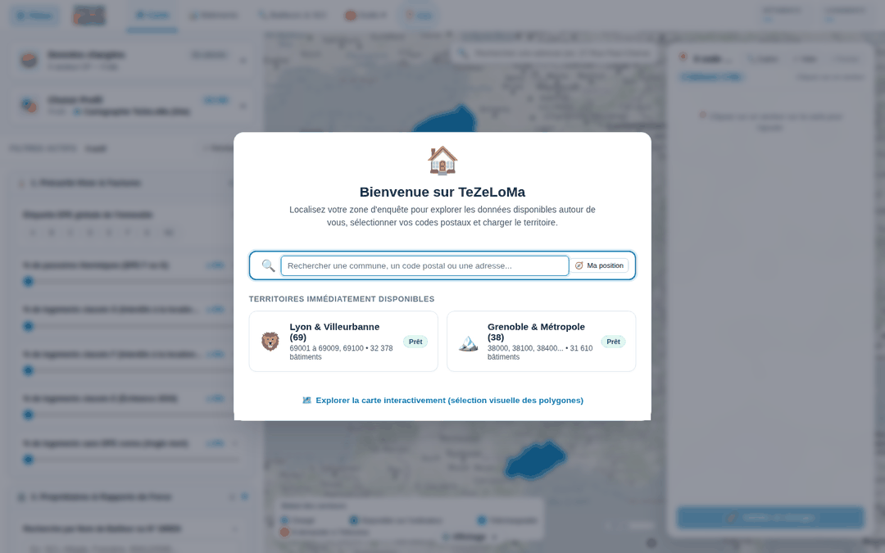
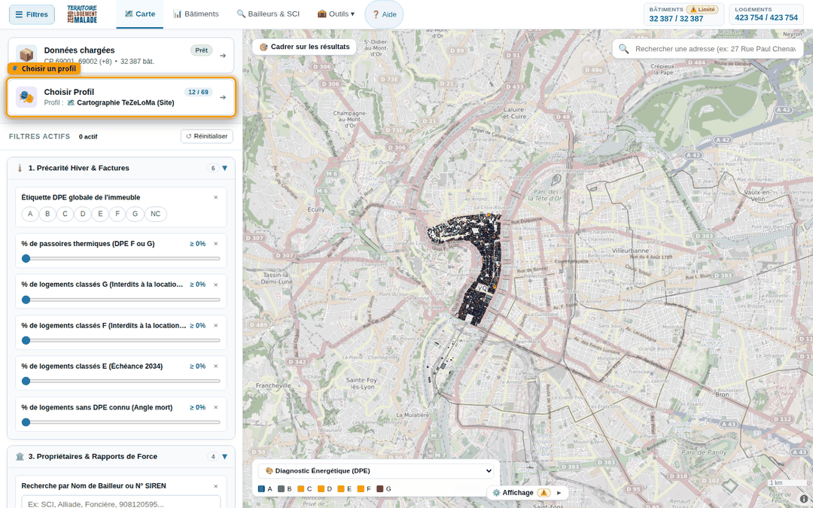
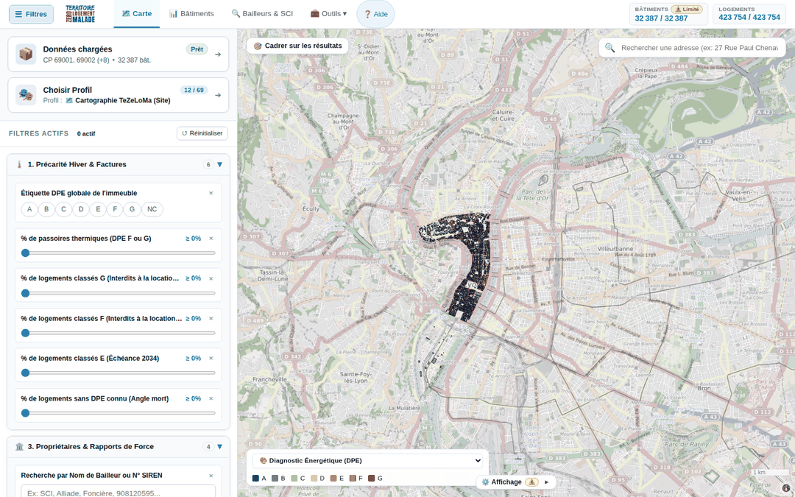
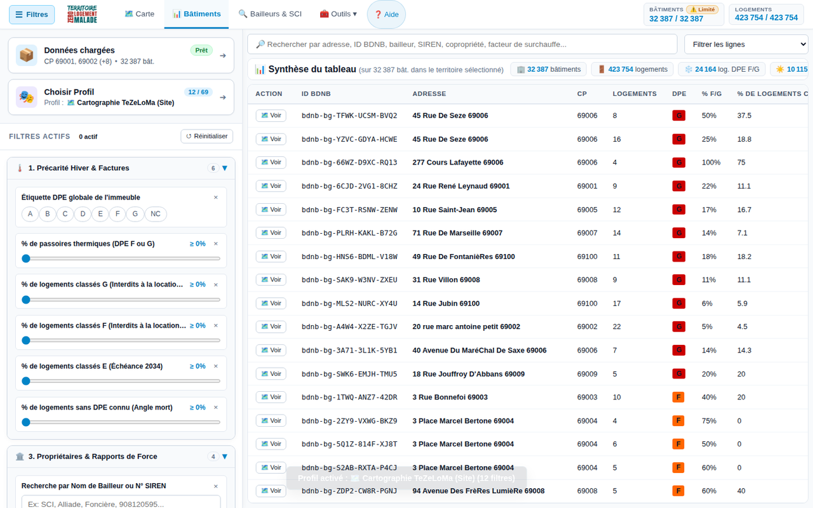
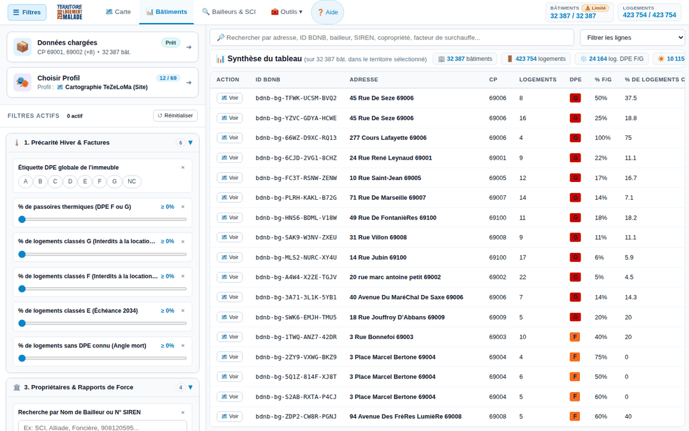

# Manuel Utilisateur — TeZeLoMa

> **TeZeLoMa — Cartographie & Enquête Bailleurs**  
> Outil d'investigation cartographique et d'analyse foncière pour identifier les passoires thermiques (précarité énergétique hivernale), le confort d'été dégradé (surchauffe estivale / « bouilloires ») et la concentration des bailleurs personnes morales (SCI, foncières, institutionnels).

---

## Table des matières

1. [Démarrage et chargement d'un territoire](#1-démarrage-et-chargement-dun-territoire)
2. [Beaucoup de données : pourquoi les Profils et les Filtres ?](#2-beaucoup-de-données--pourquoi-les-profils-et-les-filtres-)
3. [Profils (personnaliser l'information visible)](#3-profils-personnaliser-linformation-visible)
4. [Onglet 🗺️ Carte interactive](#4-onglet-️-carte-interactive)
5. [Onglet 📊 Bâtiments (tableau et interactions)](#5-onglet--bâtiments-tableau-et-interactions)
6. [Onglet 🔍 Bailleurs & SCI (enquête sur les propriétaires)](#6-onglet--bailleurs--sci-enquête-sur-les-propriétaires)
7. [Menu 🧰 Outils (Terrain, Exports, Sources)](#7-menu--outils-terrain-exports-sources)
8. [Fonctionnement hors-ligne et sauvegarde sur cet ordinateur](#8-fonctionnement-hors-ligne-et-sauvegarde-sur-cet-ordinateur)
9. [Dépannage et gestion de la mémoire](#9-dépannage-et-gestion-de-la-mémoire)
10. [Régénérer les captures et GIFs du manuel](#10-régénérer-les-captures-et-gifs-du-manuel)

---

## 1. Démarrage et chargement d'un territoire

### 1.1 Fenêtre d'accueil (*Bienvenue sur TeZeLoMa*)

Lors de votre première visite, une fenêtre vous invite à choisir votre zone d'enquête :

- **Recherche rapide** : saisissez une commune, un code postal ou une adresse dans le champ *Rechercher une commune, un code postal ou une adresse...*.
- **Géolocalisation** : cliquez sur **🧭 Ma position** pour centrer la carte autour de votre position GPS.
- **Territoires prêts à l'emploi** : cliquez directement sur une carte de raccourci (ex. **🦁 Lyon & Villeurbanne (69)**, **🏔️ Grenoble & Métropole (38)**).
- **Exploration libre** : cliquez sur **🗺️ Explorer la carte interactivement (sélection visuelle des polygones)** pour choisir manuellement vos codes postaux sur la carte.

> **Territoires disponibles :** les micro-chunks pré-compilés couvrent notamment les départements **34 (Hérault)**, **38 (Isère)**, **44 (Loire-Atlantique)**, **69 (Rhône)** et **76 (Seine-Maritime)**. Si vous cliquez sur une commune dont les chunks ne sont pas encore compilés dans votre version, une fenêtre *⏳ Données Disponibles à la Demande* vous informe de la disponibilité des données sources BDNB.



### 1.2 Sélection visuelle des secteurs & Gestionnaire de données

- En mode sélection sur la carte, cliquez sur un ou plusieurs polygones de **codes postaux**, puis utilisez la barre flottante à droite (**🔍 Cadrer**, **↺ Vider**, **× Fermer**, **🚀 Valider et charger**).
- À tout moment, cliquez sur **📦 Données chargées** en haut du panneau gauche pour modifier vos secteurs, changer la source (*Local*, *GitHub Releases*, URL personnalisée) ou **🗑️ Vider le cache local**.

---

## 2. Beaucoup de données : pourquoi les Profils et les Filtres ?

Les bases publiques ouvertes (BDNB, ADEME DPE, fichiers fonciers MAJIC, îlots de chaleur urbains, encadrement des loyers, DVF, RNIC, RPLS…) contiennent **une quantité considérable d'informations** sur chaque immeuble. Tout afficher simultanément serait illisible — et vous n'avez pas besoin de tout pour chaque enquête.

Le travail dans TeZeLoMa repose donc sur **deux étapes complémentaires** :

1. **Choisir ou créer un Profil pour trier les informations :** un profil permet de sélectionner uniquement les **colonnes**, les **indicateurs filtrables** et les **légendes** que vous souhaitez voir dans l'application.
2. **Activer des Filtres pour cibler les bâtiments :** limiter les colonnes rend l'interface claire, mais il reste encore **des milliers de bâtiments** sur le territoire. En activant des **filtres** dans le panneau latéral gauche (ex. DPE F/G, risque de surchauffe élevé, bailleur personne morale…), vous isolez uniquement les immeubles qui vous intéressent.

---

## 3. Profils (personnaliser l'information visible)

Cliquez sur **🎭 Choisir Profil** dans le panneau gauche pour ouvrir le catalogue d'indicateurs. Vous pouvez partir d'un modèle prêt à l'emploi ou composer entièrement votre vue :

- **Colonnes visibles :** cochez les indicateurs à afficher dans le tableau **📊 Bâtiments** et dans vos exports.
- **Indicateurs sur lesquels filtrer :** chaque indicateur coché apparaît automatiquement dans votre panneau de filtres à gauche (utilisez la barre de recherche et les onglets thématiques du catalogue pour retrouver rapidement un indicateur).
- **Légendes cartographiques :** adaptez les axes de coloration disponibles sur la carte.
- **Sauvegarde personnalisée :** cliquez sur **💾 + Sauvegarder ce profil** pour créer votre propre raccourci (icône, nom, description, et option *Mémoriser aussi les seuils et valeurs actuellement réglés*), puis validez avec **✅ Valider et revenir à l'enquête**.



---

## 4. Onglet 🗺️ Carte interactive

- **Barre de recherche d'adresse** (*🔍 Rechercher une adresse...*) : saisissez une rue ou une adresse pour zoomer directement dessus.
- **🎯 Cadrer sur les résultats** (en haut à gauche) : ajuste automatiquement la vue de la carte pour englober les bâtiments filtrés.
- **Sélecteur de coloration** (en bas à gauche) : basculez entre **🎨 Diagnostic Énergétique (DPE)**, **☀️ Risque Surchauffe Estivale**, **🏢 Concentration Foncière** et **📋 Enquête de Terrain** (dès qu'un fichier terrain est importé).
- **⚙️ Affichage** (panneau repliable en bas au centre) :
  - **Fond neutre** (`0%` à `100%`) : atténue le fond de carte pour mieux faire ressortir les bâtiments.
  - **Limite bât.** (`1 500`, `3 000`, `5 000` ou `Tous les bât.`) : préserve la fluidité d'affichage (un badge **⚠️ Limité** s'affiche si le plafond est atteint).
- **Clic sur un bâtiment :** ouvre sa **fiche détaillée** à droite (DPE, score et facteurs de surchauffe, propriétaires personnes morales, encadrement des loyers, marché DVF, QPV, RPLS, copropriété RNIC, détails techniques et lien vers la traçabilité).



---

## 5. Onglet 📊 Bâtiments (tableau et interactions)

L'onglet **📊 Bâtiments** permet de passer de la vue carte à une **analyse ligne par ligne** des immeubles retenus par vos filtres, en n'affichant que les colonnes choisies dans votre profil actif :

- **Recherche instantanée :** filtrez par adresse, `ID BDNB`, nom de bailleur, `SIREN`, nom de copropriété ou facteur de surchauffe.
- **Mode *Filtrer* vs *Surligner* :**
  - **Filtrer les lignes** n'affiche que les bâtiments correspondant à votre recherche.
  - **Surligner les lignes** met les correspondances en évidence tout en conservant l'ensemble du tableau autour pour garder le contexte.
- **Bandeau de synthèse :** affiche en temps réel le nombre de **bâtiments**, **logements**, **logements DPE F/G**, bâtiments en **surchauffe** et bâtiments **avec bailleur PM**.
- **Bouton *Voir* :** cliquez sur **Voir** sur n'importe quelle ligne pour basculer automatiquement sur la carte, centrer sur l'immeuble et ouvrir sa **fiche détaillée**.



---

## 6. Onglet 🔍 Bailleurs & SCI (enquête sur les propriétaires)

L'onglet **🔍 Bailleurs & SCI** est conçu pour repérer les **propriétaires personnes morales** (SCI, foncières, sociétés commerciales, bailleurs sociaux) qui concentrent des logements dans votre sélection et pour identifier les personnes physiques qui les dirigent :

- **Tableau *Top Propriétaires Personnes Morales dans la sélection active* :**
  - Classe les entités morales par nombre de locaux détenus dans votre sélection, avec leur **SIREN**, **Dénomination**, **Forme Juridique**, **Bâtiments (sélection)**, **Locaux (sélection)**, **Patrimoine Total (locaux)** et **Commune du Siège**.
  - Cliquez sur n'importe quel en-tête de colonne pour trier le tableau.
- **Inspection en direct des dirigeants (API Gouv) :**
  - Sélectionnez un bailleur dans le tableau / la liste déroulante, ou saisissez directement un numéro **SIREN** ou un nom (ex. `908120595` ou `SCI...`) puis cliquez sur **🔎**.
  - L'application interroge en direct l'API publique **Recherche Entreprises** (`recherche-entreprises.api.gouv.fr`) et affiche :
    - les informations légales de l'entreprise (raison sociale, SIREN, adresse du siège, activité principale) ;
    - la liste des **dirigeants / gérants** (nom, prénoms, année de naissance, qualité/fonction) ;
    - le tableau complet des **immeubles détenus par cette entité** sur le territoire actif.



---

## 7. Menu 🧰 Outils (Terrain, Exports, Sources)

### 📋 Enquête de Terrain (.xlsx, .xls, .csv)

**Ajoutez vos propres données :** vous pouvez extraire votre sélection au format Excel depuis **📥 Exporter**, y ajouter vos propres colonnes (ex. `statut`, `notes`, `priorite`), puis réimporter le fichier ici en tant qu'**« Enquête de Terrain »**.

- Les informations que vous ajoutez sont affichées dans le tableau **📊 Bâtiments** et incluses dans vos exports.
- Chaque colonne ajoutée devient un **filtre** dans le panneau latéral gauche.
- Vous pouvez aussi utiliser vos colonnes pour **colorer la carte** via le sélecteur de légende.
- Vos enquêtes sont enregistrées sur cet ordinateur (activation, mise à jour ou suppression à tout moment).

### 📥 Exporter (PNG, Excel, Word, ZIP)

L'export porte toujours sur votre **sélection active filtrée** :
- **🗺️ Carte (.png)** : capture haute résolution avec légende active, territoire et compteur.
- **📊 Tableau Bâtiments (.xlsx)** et **🏛️ Tableau Bailleurs (.xlsx)** : tableurs Excel complets (incluant vos colonnes de terrain).
- **📝 Rapport Complet Word (.docx)** : document configurable (Contexte & Synthèse, Carte, Tableau des Bâtiments max 400 lignes, Tableau des Bailleurs & SCI).
- **📦 Télécharger le .zip** : archive brute complète (Excel + GeoJSON + README).

### 📚 Sources de données

- **📋 Dictionnaire des Informations & Traçabilité** : recherchez n'importe quel indicateur ou colonne brute, filtrez par thématique, producteur ou usage, ou exportez le dictionnaire en **CSV**.
- **📦 Référentiels Bruts & Territoires** : détaille les sources nationales et locales intégrées.

---

## 8. Fonctionnement hors-ligne et sauvegarde sur cet ordinateur

- **Usage hors-ligne :** une fois vos codes postaux chargés, les paquets de données sont enregistrés sur cet ordinateur. Vous pouvez rouvrir vos territoires et travailler sans connexion Internet (seule l'interrogation en direct des dirigeants via `recherche-entreprises.api.gouv.fr` nécessite Internet).
- **Sauvegarde automatique :** territoire actif, profil, profils personnalisés, filtres et enquêtes de terrain sont conservés sur cet ordinateur.

---

## 9. Dépannage et gestion de la mémoire

- **Fluidité et mémoire d'affichage (carte) :** dessiner des dizaines de milliers de polygones simultanément sollicite la mémoire graphique du navigateur. Dans **⚙️ Affichage** (en bas de la carte), réglez **Limite bât.** (`1 500`, `3 000`, `5 000` ou `Tous les bât.`). Lorsque le plafond est atteint, le badge **⚠️ Limité** s'affiche : zoomez sur un quartier ou affinez vos filtres pour afficher tous les bâtiments de la zone.
- **Stockage local et cache (`Cache API` / `localStorage`) :** les paquets de données téléchargés ainsi que vos profils personnalisés, filtres et enquêtes de terrain sont stockés localement dans le navigateur.
- **Forcer un rechargement ou libérer de l'espace :** si un territoire semble obsolète ou bloqué au chargement, ouvrez **📦 Données chargées** en haut du panneau gauche puis cliquez sur **🗑️ Vider le cache local**.
- **Interrogation des dirigeants (API Gouv) :** si la fiche d'un bailleur reste en attente, vérifiez votre connexion Internet ou réessayez après quelques secondes (l'API publique `recherche-entreprises.api.gouv.fr` peut limiter temporairement les requêtes trop rapprochées).

---

## 10. Régénérer les captures et GIFs du manuel

Ce manuel est intégré directement dans l'application via **❓ Aide** (ou **🧰 Outils ▸ 📖 Manuel Utilisateur**).  
Pour mettre à jour automatiquement toutes les captures PNG et animations GIF après une évolution de l'interface :

```bash
.venv/bin/python app/generate_manual_media.py
```
